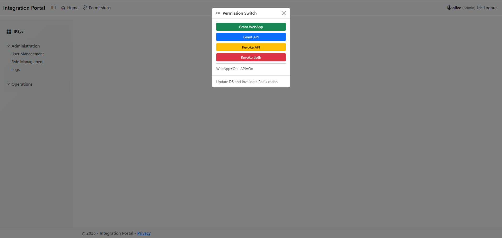
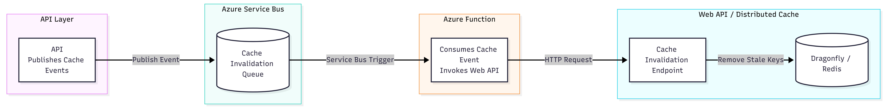

# 🚀 MessageHubAzure 

[](https://github.com/hasanjaved-developer/MessageHubAzure/actions/workflows/dotnet-tests.yml)
[](https://codecov.io/gh/hasanjaved-developer/MessageHubAzure)
[](https://github.com/hasanjaved-developer/MessageHubAzure/actions/workflows/docker-compose-ci.yml)
[](LICENSE.txt)
[](https://github.com/hasanjaved-developer/MessageHubAzure/tags)

[](https://ghcr.io/hasanjaved-developer/message-hub-azure/api)
[](https://ghcr.io/hasanjaved-developer/message-hub-azure/userapi)
[](https://ghcr.io/hasanjaved-developer/message-hub-azure/web)
[](https://ghcr.io/hasanjaved-developer/message-hub-azure/function-invalidator)

### 🐳 Docker Hub Images

| Service | Pulls | Size | Version |
|----------|-------|------|----------|
| **API** | [](https://hub.docker.com/r/hasanjaveddeveloper/message-hub-azure-api) | [](https://hub.docker.com/r/hasanjaveddeveloper/message-hub-azure-api/tags) | [](https://hub.docker.com/r/hasanjaveddeveloper/message-hub-azure-api/tags) |
| **User API** | [](https://hub.docker.com/r/hasanjaveddeveloper/message-hub-azure-userapi) | [](https://hub.docker.com/r/hasanjaveddeveloper/message-hub-azure-userapi/tags) | [](https://hub.docker.com/r/hasanjaveddeveloper/message-hub-azure-userapi/tags) |
| **Web (Portal)** | [](https://hub.docker.com/r/hasanjaveddeveloper/message-hub-azure-web) | [](https://hub.docker.com/r/hasanjaveddeveloper/message-hub-azure-web/tags) | [](https://hub.docker.com/r/hasanjaveddeveloper/message-hub-azure-web/tags) |
| **Function-Invalidator** | [](https://hub.docker.com/r/hasanjaveddeveloper/message-hub-azure-function-invalidator) | [](https://hub.docker.com/r/hasanjaveddeveloper/message-hub-azure-function-invalidator/tags) | [](https://hub.docker.com/r/hasanjaveddeveloper/message-hub-azure-function-invalidator/tags) |


**MessageBus** is a lightweight, Azure-integrated message pipeline focused on **event-driven cache invalidation** in .NET applications.

It provides a clean pattern for publishing events from APIs after completing database updates to an **Azure Service Bus queue**, and processing those events asynchronously using independent Azure Function worker.

The worker invokes the Web API's cache invalidation endpoint, which removes stale keys from the distributed cache (Dragonfly/Redis).

This approach keeps APIs fast and responsive while ensuring cache consistency across services.

The worker’s responsibility is only to remove stale keys. Any pre-warm logic (such as regenerating and repopulating cache values) remains inside the web application and will execute naturally on the next access after invalidation.

**A single role update can affect hundreds of users — so distributed cache invalidation is essential for consistent authorization.**

---

## 🔧 Features
### ✔️ Azure Service Bus Messaging

An event-publishing pattern using Azure Service Bus Queue supporting:

- Asynchronous message delivery

- Queue-based message processing

- JSON serialization

- Decoupled event publishing and consumption

### ✔️ Cache Invalidation Worker

An Azure Function worker triggered by Azure Service Bus messages that:

- Receives cache invalidation events from Azure Service Bus

- Invokes the Web API's cache invalidation endpoint

- Removes stale keys from Dragonfly/Redis through the Web API

- Optionally logs the invalidation action

The worker runs independently and never blocks the API.

### ✔️ Clean Publish → Process Pattern

A standard flow:

1. API completes database update

2. API publishes a cache-related event

3. Azure Service Bus delivers the message to a queue.

4. Azure Function consumes the message.

5. Function invokes the Web API's cache invalidation endpoint.

6. Web API removes the relevant keys from Dragonfly/Redis.

---

## 🧱 Architecture Snapshot

  
<sub>[View Mermaid source](docs/Azure%20Integrated%20Portal.mmd)</sub>

---

### 📸 Screenshots

---

### 🔐 Permission Change Trigger (UI Action That Publishes the Event)



## 🧩 Azure Function — Processing PermissionInvalidation Messages

  
<sub>[View Mermaid source](docs/cache_invalidation_diagram.mmd)</sub>

---

## 🔍 Quick Start (Preview)

```bash
# Clone the repository
git clone https://github.com/hasanjaved-developer/message-hub-azure.git
cd message-hub-azure

# Start the observability stack
docker compose -f docker-compose.yml up -d
```
---

## 📜 License

This project is licensed under the MIT License.

---
